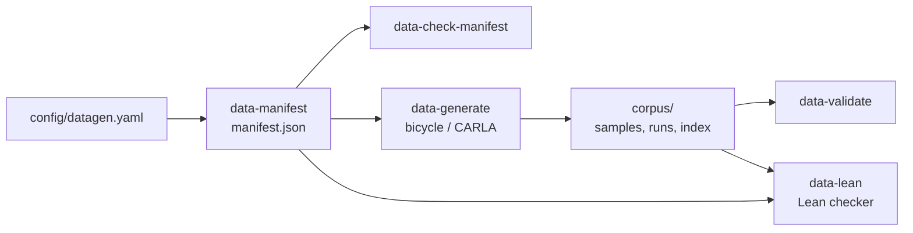

# Imitation-data generation: certified contrastive corpus

This is the data side of an imitation-learning controller. It generates a declared catalogue of
decision situations, drives each one with a deterministic expert through the harness, records the
exact controller observations with expert labels and outcomes, and checks the result: in Python
(`data-validate`) and in Lean 4 (`data-lean`). Training, inference and ONNX export are out of
scope.



## 1. Scenario family `brake_turn_obstacle` v1

A straight approach at a declared speed, then a constant-radius turn with an unmapped obstacle
cone group inside the turn. At the hand-over point both the turn and the obstacle are beyond the
road model's preview, so they appear while the expert is driving: it must decide when to brake,
how fast to corner and which side of the obstacle to use.

| Factor (coverage dimension) | Unit | Bins |
|---|---|---|
| `turn_radius_m` | m | tight [9, 14), medium [14, 22), open [22, 35] |
| `turn_direction` | - | left, right |
| `preview_m` (= `road_model.range_m`) | m | short [15, 25), nominal [25, 45), long [45, 60] |
| `approach_speed_mps` (speed at hand-over) | m/s | low [8, 12), mid [12, 16), high [16, 20] |
| `obstacle_side` (relative to the turn) | - | inside, outside |
| `obstacle_clearance_m` (obstacle inner edge to opposite boundary) | m | tight [2.8, 3.3), moderate [3.3, 3.9), wide [3.9, 4.6] |
| `road_width_m` | m | narrow [5.0, 5.6), standard [5.6, 6.8), wide [6.8, 8.0] |

Nuisance parameters vary inside a cell (seeded) but are not coverage dimensions:
`turn_angle_deg` [70, 110] and `obstacle_arc_frac` [0.30, 0.60] (obstacle station along the arc).

**Validity.** Parameters are quantised to 1e-3 of their unit. Rejections are recorded with
reasons, never dropped:
- `schema:*` means a missing or extra parameter, a wrong type, or a value off the 1e-3 grid.
- `formal:*` covers bounds, `clearance ≤ width − 0.6 − 0.6` (at least two cones, 0.6 m inside the
  boundary) and `2·radius ≥ width + 3` (the course builder's rule). These are modelled
  identically in Lean.
- `sim:*` covers course-builder checks (`Track.validate`), obstacle cones realised exactly as
  declared, exactly one detected corner in the right direction containing the obstacle, and
  the finish beyond the decision window.
- `duplicate_of:<id>`: the same parameters were already accepted.

**Adding a family.** Subclass `Family` in `autocross/datagen/spec.py` (factors, nuisance, constants,
`formal_violations`, `layout`, `track_spec`, `sim_overrides`, `expert_config`,
`simulator_violations`), register it in `FAMILIES`, and add its spec and structural constraint to
`lean/Corpus/Spec.lean`. The manifest, generator, validator and checker are otherwise family-agnostic;
the Lean checker fails until both sides agree.

## 2. Manifest (`autocross.datagen.manifest`, schema 1)

`python -m autocross data-manifest --profile smoke|full|large --out M.json` builds it from
`config/datagen.yaml`; it is a pure function of that file, the profile and the generator version
(no timestamps in the hashed content).

- **Coverage design.** `strength: 1` uses diagonal rows that cover every bin of every factor.
  `strength: 2` is a deterministic greedy pairwise cover that hits every pair of bins of every
  two factors (154 cells). Each row gets `replicates` independent in-cell draws. A draw that
  violates a constraint is recorded as rejected and redrawn (`max_attempts`). Random sampling
  alone is never relied on for coverage.
- **Contrast pairs.** For every accepted base and every `contrast_factors` entry, the factor
  moves to another bin (farthest first) and keeps its relative position inside the bin. Every
  other parameter, including nuisance values, is copied. Each pair declares `factor`, `fixed`
  (all other parameters) and an `expected_effect` hypothesis. `turn_direction` contrasts are
  geometric mirror images. Unavailable contrasts are listed in `gaps` with the reason.
- **IDs and hashes.**
  - `scenario_sha256` is the SHA-256 of the canonical JSON {family, version, integer params}.
  - `scenario_id` is `bto-v1-<16 hex>`.
  - `track_spec_sha256` hashes the course spec.
  - `content_sha256` hashes the manifest minus `provenance` (git state, design copy).
- **Splits** are assigned by parameter region, not seed. A region is a cell of `region_factors`
  (`turn_radius_m × preview_m`). Listed regions go to `val`/`test` and the rest to `train`. A
  scenario's split is its own region's split. A contrast whose variant would land in another
  split's region is skipped and reported. As a result, held-out regions never appear in any
  other split, and every contrast pair and group stays within one split.
  - Default `val` = (open, nominal), `test` = (medium, short).
  - `group_id` = `grp-<base id>` (base + its contrasts).
- **Coverage report** lists required cells, cells covered by accepted scenarios, and missing cells.

| Profile | Accepted scenarios | Contrast pairs | Cells |
|---|---|---|---|
| smoke | 20 | 17 | 19 (strength 1) |
| full | 212 | 184 | 154 (strength 2) |
| large | about 4× full | | 154 |

## 3. Expert (`autocross/datagen/expert.py`, version in `EXPERT_VERSION`)

The expert runs as a normal sandboxed controller in event mode: no map, and the course name is
withheld. After the hand-over point its command is a **pure function of the observation and
the published `VehicleParams`** (`expert_action(obs, vp, None)`). It does not read world pose,
progress or cones, and it keeps no state. Every decision label can therefore be recomputed from
the recorded observation; `data-validate` does so for every expert-phase sample (exact match
required).

Before hand-over, a scripted speed hold brings the car to the declared approach speed. It uses
privileged scenario configuration, and those samples are phase `approach`, never clean.

**Longitudinal decision: certified.** Model M = `cert-1` (`autocross/datagen/cert.py`, mirrored by
`lean/Corpus/Cert.lean`) works on the observation quantised to integers: stations in mm,
curvature in 1e-6/m, speed in mm/s. The unknowns are the squared speeds b_i at the preview
stations, subject to:

- **Grip:** b_i · κ̄_i ≤ a_lat. κ̄_i bounds the planned path's curvature: road curvature, plus the
  sidestep curvature 6|y|/R_SW², divided by (1 − |κ||y|).
- **Gap speed:** beside an obstacle, b_i ≤ (5 + 6·slack)².
- **Speed cap:** b_i ≤ V_MAX².
- **Horizon:** b_n ≤ a_lat · R_H. A 9 m corner could start right after the preview.
- **Budgets:** b_{i+1} ≤ b_i + 2·a_acc·Δs and b_i ≤ b_{i+1} + 2·a_brk·Δs.
- **Start:** b_0 = v².

Budget values: a_lat = `A_LAT_FRAC`·μg, a_brk = `A_BRAKE_PLAN`, a_acc = published max accel.

The label is one of:
- **`greatest_safe`**: the acceleration to F_1, where F is the forward–backward profile. Lean
  proves (`decide_greatest_safe`, from `fpass_greatest`) that no feasible profile from the
  current speed reaches the next station faster. In other words, no command that keeps the
  plan feasible for every continuation consistent with what is visible can be faster.
  `fpass_feasible` proves F itself is feasible, and `greatest_minimises` shows F minimises any
  traversal-time objective that decreases with speed.
- **`min_violation`**: the car is already over budget (b_0 > B_0). Full braking at `max_decel`
  gives the pointwise-least possible speeds (`brake_least`, `decide_min_violation`), so it
  minimises every constraint violation.
- **`no_feasible_gap`** / **`invalid_input`**: no certificate. These samples are never clean.

Lean recomputes the decision from the exported quantised observation for every expert-phase
sample and requires every clean sample to be `greatest_safe` or `min_violation`.

**Lateral plan and steering: NOT certified.** The plan is the perceived centerline, shifted into
the centre of the wider free gap beside each visible obstacle. Side and target use the same
station widths as model M. Smoothstep ramps are 18 m in and 15 m out, held ±3 m around the
obstacle, and the path is clamped 0.3 m inside the boundaries. Pure pursuit tracks it. Pedals
map the certified acceleration linearly onto throttle/brake; that mapping is a tracking layer.

**Assumptions and limitations.**
- "Optimal" means optimal for model M on the quantised observation: point-mass grip/budget
  constraints at 1 m stations, with the declared horizon assumption.
- It is not a claim about the simulator's tyre physics, the lateral line, or time-optimal
  driving of the whole course.
- The road model is used as given; with noisy lane models the label is optimal for the noisy
  observation.
- Pure pursuit lags on tight, rapidly varying paths. Runs where this causes a cone hit are
  excluded, which biases the clean set away from the hardest cells (see the per-split coverage
  in `index.json`).

## 4. Corpus layout and sample record

```
<corpus>/manifest.json          byte copy of the manifest
<corpus>/tracks/<id>.yaml        course built from the scenario parameters
<corpus>/runs/<id>/              harness run: telemetry.csv, events.json, summary.json
<corpus>/samples/<id>.jsonl      one record per control step (20 Hz)
<corpus>/index.json              provenance, backend identity, per-run outcome + file hashes, totals,
                                 realised coverage
<corpus>/contrast_report.json    empirical check of each pair's declared effect (not a proof)
<corpus>/validation_report.json  data-validate output
<corpus>/lean/                   integer interchange + per-scenario certificate files
<corpus>/lean_report.json        Lean checker verdicts + axiom audit + input hashes
```

Sample record (`autocross.datagen.sample`, schema 1). SI units, vehicle frame x forward / y left.
`null` means NaN.

| Field | Content |
|---|---|
| `sample_id` | `<scenario_id>:<step:05d>` (stable) |
| `scenario_id`, `group_id`, `family`, `split`, `backend` | identity; `backend` is `bicycle` or `carla` in every record |
| `observation` | the full `Observation` the controller received: ego state, applied actuators, road model (all preview arrays, corners, obstacles), cone detections. `x, y, yaw, progress, lap, t, step, timing_started` are available to a controller but identify the layout; do not use them as policy inputs |
| `expert` | proposed action: `steer, throttle, brake, target_speed, path` (vehicle frame); `status`; `certificate` (`model, kind, certified, accel_mps2, accel_mm_s2, b1/b0/B0` integers); `debug` |
| `applied` | actuator values the simulator applied on the first and last physics tick of the period (after the steering slew limit), `command_held`, `command_clipped` |
| `outcome` | `off_course`, events during the period (cone hits, ...), minimum boundary margin, progress |
| `oracle` | privileged ground truth (distances to corner entry, obstacle, hand-over; true obstacle extent; phase). Diagnostics only: never an input or a target |
| `timing` | wall-clock step latency (nondeterministic; excluded from hashes) |
| `quality` | `clean`, `exclusion_reasons`, `label_replay_max_abs_diff` |
| `content_sha256` | SHA-256 of (observation, expert steer/throttle/brake) |

**Clean** means all of the following:
- the decision-window phase, from hand-over to 20 m past the turn exit;
- a clean run: finished, no cone hit, no off-course, no missed gate, no controller error, no
  held command;
- the hand-over realised (speed within 0.5 m/s, |lateral| ≤ 0.25 m, |heading| ≤ 0.035 rad,
  nothing visible yet);
- a certified decision (`greatest_safe` or `min_violation`);
- an unclipped command;
- an exact label replay.

Failed or ambiguous runs stay in the corpus with `clean: false` and reasons. One failure excludes
the whole run, not just the nearby samples.

**Imitation targets.** `expert.certificate.accel_mps2` is the certified longitudinal decision.
`expert.steer`, `expert.path`, `throttle` and `brake` are the uncertified tracking outputs.

## 5. Validation (`data-validate`)

`data-validate` recomputes and fails on any of:
- schema/version errors;
- a manifest that fails `check_manifest`;
- manifest/index hashes;
- file SHA-256s;
- the course YAML not matching the manifest parameters;
- run provenance: backend, seed, preview range, expert hash, perception (no-map) mode;
- run outcome and failure list recomputed from samples + `events.json` + `summary.json`;
- contiguous steps and stable sample IDs;
- identity fields and content hashes;
- finite numbers and command ranges;
- applied actuation equal to the actuator model applied to the proposed action;
- exclusion reasons recomputed from the record;
- label replay for every expert-phase sample (exact, including the certificate integers);
- identical clean content in two splits;
- group, scenario hash or contrast pair spanning splits;
- a scenario whose split differs from its region's split;
- realised coverage: cells covered by clean runs. Missing cells are errors unless
  `--allow-missing-coverage`.

## 6. Lean (`lean/`, Lean 4.35.0, core only)

`data-lean <manifest.json | corpus>` exports integers only (`lean/interchange.json`,
`lean/certs/*.json`), builds the checker, runs it, and runs the axiom audit
(`Corpus/Audit.lean`: only `propext`, `Classical.choice`, `Quot.sound`; no `sorry`).

**Theorems** (kernel-checked when `lake build` succeeds):

| Theorem | Statement |
|---|---|
| `Cert.le_bpass`, `Cert.fpass_greatest` | every feasible profile is ≤ the backward pass / ≤ the forward–backward profile |
| `Cert.fpass_feasible` | the forward–backward profile is feasible (non-negative budgets and gaps) |
| `Cert.brake_least` | full braking is the pointwise-least possible profile |
| `Cert.greatest_minimises` | a pointwise-greatest profile minimises any speed-antitone objective |
| `Cert.decide_greatest_safe`, `Cert.decide_min_violation` | link the decision function to the two certificates |
| `adjCheck_sound` | the linear check on hash-sorted clean samples implies no content in two splits |
| `pairs_within_split` | group consistency + pair integrity ⇒ no pair crosses splits |
| `full_coverage_of_exact` | an exact coverage report with no missing cells ⇒ every required cell is covered |
| `mirrorObs_involutive`, `mirrorAct_involutive`, `mirror_gap_swap`, `mirror_interval`, `mirror_steer_bound`, `chooseSide_mirror` | the mirror transform is an involution; it swaps gaps, keeps obstacle intervals and steering bounds; the gap-side rule flips (strict cases; the expert's exact-tie break is not mirror-symmetric) |

**Checks on the actual artifacts** (each a `Decidable` proposition, or a checker with a soundness
theorem):

- spec equality with `Corpus.btoSpec`;
- Python's formal verdict ⇔ Lean's `Valid` for every exported draw;
- accepted scenarios valid, with correct bins;
- unique IDs and hashes;
- contrast-pair integrity;
- the split rule, group/hash split consistency;
- required cells and exact manifest coverage;
- realised coverage exactness;
- no clean content in two splits;
- the Python mirror transform equals the Lean one on exported samples;
- certified decisions recomputed for every expert-phase sample;
- every clean label certified.

**Trust boundary.** Lean proves properties of its own model, and the checker decides them on the
integers it is given. Trusted and unverified:
- the Lean compiler and runtime;
- JSON decoding;
- the Python export: float → fixed-point quantisation, and the choice of which samples are
  exported. The validator cross-checks this against the records.

Not covered at all:
- whether model M describes the simulator (CARLA or bicycle) or a real car;
- the uncertified steering/path;
- whether a policy trained on the data generalises;
- anything about CARLA physics or Python execution.

## 7. Reproducibility

- Same design file + profile + generator/family version → byte-identical manifest content,
  scenario IDs and hashes (tested).
- Each scenario has its own `sim_seed` (derived from its ID) for the cone sensor noise.
- On the bicycle backend, repeated generation gives identical sample content hashes (tested).
  `timing` and `wall_time_s` differ.
- CARLA physics in synchronous mode is close to but not guaranteed deterministic (physics
  substeps, knockable cones). Compare content hashes, and expect small differences.
- `index.json` records:
  - generator version and git commit/dirty state;
  - manifest file and content hashes;
  - backend identity (bicycle model source hash and parameters, or the CARLA server/client
    versions);
  - expert version, source hash and parameters;
  - certificate model and source hash;
  - the resolved simulation config and its hash;
  - per-scenario overrides;
  - Python/numpy/platform.

## 8. CARLA

`data-generate --backend carla` requires the `carla==0.9.16` client (Python 3.10–3.12) and a
reachable server. Otherwise it stops before writing anything, with a message and exit code 3.
CARLA corpora are generated with one worker. The bicycle backend corpus is labelled `bicycle` in
every record and in `index.json`; it is a tooling and logic check, not evidence about CARLA.
