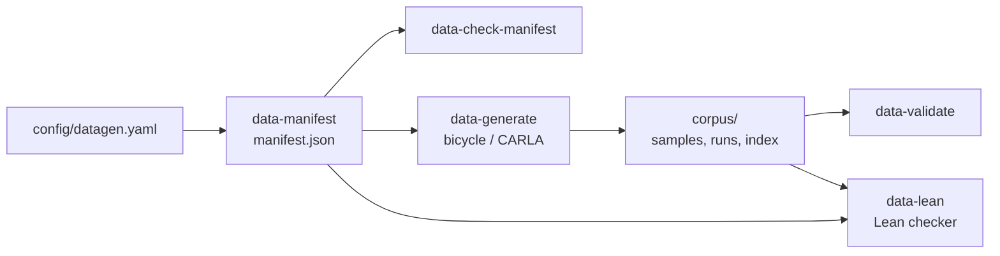

# Imitation-data generation: certified contrastive corpus

This is the data side of an imitation-learning controller. It generates a declared catalogue of
decision situations, drives each one with a deterministic expert through the harness, records the
exact controller observations with expert labels and outcomes, and checks the result: in Python
(`data-validate`) and in Lean 4 (`data-lean`). Training, inference and ONNX export are out of
scope.



## 1. Scenario family `brake_turn_obstacle` v1

A straight approach at a declared speed, then a constant-radius turn with an unmapped obstacle
cone group inside the turn. At the hand-over point both the turn and the obstacle are beyond the
road model's preview, so they appear while the expert is driving: it must decide when to brake,
how fast to corner and which side of the obstacle to use.

| Factor (coverage dimension) | Unit | Bins |
|---|---|---|
| `turn_radius_m` | m | tight [9, 14), medium [14, 22), open [22, 35] |
| `turn_direction` | - | left, right |
| `preview_m` (= `road_model.range_m`) | m | short [15, 25), nominal [25, 40] (event: 40 m; shorter = robustness-sweep sight loss) |
| `approach_speed_mps` (speed at hand-over) | m/s | low [8, 12), mid [12, 16), high [16, 20] |
| `obstacle_side` (relative to the turn) | - | inside, outside |
| `obstacle_clearance_m` (obstacle inner edge to opposite boundary) | m | tight [2.8, 3.3), moderate [3.3, 3.9), wide [3.9, 4.6] |
| `road_width_m` | m | narrow [5.0, 5.6), standard [5.6, 6.8), wide [6.8, 8.0] |

Nuisance parameters vary inside a cell (seeded) but are not coverage dimensions:
`turn_angle_deg` [70, 110] and `obstacle_arc_frac` [0.30, 0.60] (obstacle station along the arc).

**Validity.** Parameters are quantised to 1e-3 of their unit. Rejections are recorded with
reasons, never dropped:
- `schema:*` means a missing or extra parameter, a wrong type, or a value off the 1e-3 grid.
- `formal:*` covers bounds, `clearance ≤ width − 0.6 − 0.6` (at least two cones, 0.6 m inside the
  boundary) and `2·radius ≥ width + 3` (the course builder's rule). These are modelled
  identically in Lean.
- `sim:*` covers course-builder checks (`Track.validate`), obstacle cones realised exactly as
  declared, exactly one detected corner in the right direction containing the obstacle, and
  the finish beyond the decision window.
- `duplicate_of:<id>`: the same parameters were already accepted.

**Adding a family.** Subclass `Family` in `autocross/datagen/spec.py` (factors, nuisance, constants,
`formal_violations`, `layout`, `track_spec`, `sim_overrides`, `expert_config`,
`simulator_violations`), register it in `FAMILIES`, and add its spec and structural constraint to
`lean/Corpus/Spec.lean`. The manifest, generator, validator and checker are otherwise family-agnostic;
the Lean checker fails until both sides agree.

## 2. Manifest (`autocross.datagen.manifest`, schema 1)

`python -m autocross data-manifest --profile smoke|full|large --out M.json` builds it from
`config/datagen.yaml`; it is a pure function of that file, the profile and the generator version
(no timestamps in the hashed content).

- **Coverage design.** `strength: 1` uses diagonal rows that cover every bin of every factor.
  `strength: 2` is a deterministic greedy pairwise cover that hits every pair of bins of every
  two factors (154 cells). Each row gets `replicates` independent in-cell draws. A draw that
  violates a constraint is recorded as rejected and redrawn (`max_attempts`). Random sampling
  alone is never relied on for coverage.
- **Contrast pairs.** For every accepted base and every `contrast_factors` entry, the factor
  moves to another bin (farthest first) and keeps its relative position inside the bin. Every
  other parameter, including nuisance values, is copied. Each pair declares `factor`, `fixed`
  (all other parameters) and an `expected_effect` hypothesis. `turn_direction` contrasts are
  geometric mirror images. Unavailable contrasts are listed in `gaps` with the reason.
- **IDs and hashes.**
  - `scenario_sha256` is the SHA-256 of the canonical JSON {family, version, integer params}.
  - `scenario_id` is `bto-v1-<16 hex>`.
  - `track_spec_sha256` hashes the course spec.
  - `content_sha256` hashes the manifest minus `provenance` (git state, design copy).
- **Splits** are assigned by parameter region, not seed. A region is a cell of `region_factors`
  (`turn_radius_m × preview_m`). Listed regions go to `val`/`test` and the rest to `train`. A
  scenario's split is its own region's split. A contrast whose variant would land in another
  split's region is skipped and reported. As a result, held-out regions never appear in any
  other split, and every contrast pair and group stays within one split.
  - Default `val` = (open, nominal), `test` = (medium, short).
  - `group_id` = `grp-<base id>` (base + its contrasts).
- **Coverage report** lists required cells, cells covered by accepted scenarios, and missing cells.

| Profile | Accepted scenarios | Contrast pairs | Cells |
|---|---|---|---|
| smoke | 20 | 17 | 19 (strength 1) |
| full | 212 | 184 | 154 (strength 2) |
| large | about 4× full | | 154 |

## 3. Expert (`autocross/datagen/expert.py`, version in `EXPERT_VERSION`)

The expert runs as a normal sandboxed controller in event mode: no map, and the course name is
withheld. After the hand-over point its command is a **pure function of the canonical policy
observation and the published `VehicleParams`**. It does not read world pose, progress, lap,
time, cones, the corner list or the finish distance, and it keeps no state. `data-validate`
re-runs it on the policy observation **with every privileged field removed**
(`records.policy_to_observation`) and requires the complete output to match: path, path frame,
steering, pedals, target speed and certificate.

Before hand-over, a scripted speed hold brings the car to the declared approach speed: a P law
far from the target, and within −0.5…+3 m/s an incremental PI on the applied throttle, damped by
`obs.ax`, which removes the steady-state offset drag causes in CARLA. It uses privileged scenario
configuration and course progress. Those samples are phase `approach`, carry no certificate and
are never clean.

Generation runs with the event's compute budget (`compute_budget.mode: enforce`: 1 core, 50 ms
deadline). A step that overruns holds the previous command, exactly as in the event.

**Longitudinal decision: certified.** Model M = `cert-2` (`autocross/datagen/cert.py`, mirrored
line by line by `lean/Corpus/Cert.lean`). It works on the policy observation quantised to
integers: stations in mm, curvature in 1e-6/m, speed in mm/s. Each number is
`floor(x·scale + ½)`, computed exactly on the decimal JSON text of the float. The unknowns are
the squared speeds b_i ≥ 0 at the preview stations, subject to:

- **Grip:** b_i · κ̄_i ≤ a_lat·10⁹. κ̄_i bounds the planned path's curvature: road curvature, plus
  the sidestep curvature 6|y|/R_SW², divided by (1 − |κ||y|).
- **Speed cap:** b_i ≤ v_max², with v_max the vehicle's `max_speed`.
- **Terminal constraint:** b_n ≤ a_lat · r_h. Here r_h = `cert.domain_horizon_mm` is the effective
  radius of the tightest planned path the **declared scenario domain** allows at any station:
  turn radius ≥ 9 m together with a sidestep of half the widest road (8 m), giving r_h = 2.55 m.
  Every unseen station of every in-domain road therefore has cap ≥ a_lat·r_h. The validator
  checks this domain assumption against every *visible* station (`domain_violations`).
- **Budgets:** b_{i+1} ≤ b_i + 2·a_acc·Δs and b_i ≤ b_{i+1} + 2·a_brk·Δs.
- **Start:** b_0 = v².

Constants (all derived, `cert.model_constants`):
- a_lat = ⌊⌊μg⌋/√2⌋. This is the half-side of the largest equal-axis box inside the friction
  circle, so every plan of M respects the friction circle of a point mass. It is sound, not
  tight.
- a_acc = min(max_accel, box), a_brk = min(max_decel, box), a_max = max_decel (full-brake label).
- veh_width from `VehicleParams`.
- hold, ramp and R_SW from the lateral planner's sidestep geometry.

A visible gap narrower than the car is `no_feasible_gap`. v1.0.0's gap-speed rule and safety
margins are gone.

The label (`target.longitudinal`) is one of:
- **`greatest_safe`**: `accel_mm_s2 = ⌊(F₁ − b₀)/(2Δs₀)⌋`, where F is the forward–backward
  profile. The Lean theorems are listed in §6. In words:
  - F is feasible, and every feasible profile is ≤ F.
  - F held at its last speed is safe on every in-domain continuation, and every profile that is
    safe on the worst continuation is ≤ F. That is, no planner with the same information does
    better.
  - The integer acceleration is the greatest integer whose end point admits a feasible profile.
    It lies within [−a_brk, a_acc].
- **`min_violation`**: already over budget (b₀ > B₀).
  - No safe profile exists.
  - Full braking at `max_decel` gives the pointwise-least speeds, so it minimises the excess over
    any upper speed caps.
  - It does **not** minimise arbitrary violation measures.
- **`no_feasible_gap`** / **`invalid_input`**: no certificate. These samples are never clean.

**Lateral plan and steering: model `steer-1`.** It reuses `cert-2`'s quantised observation (`Steer.Q = {base, lat}`). The lateral decision is an integer-exact Lean-defined function; the Python expert publishes the path from that function, and the validator recomputes it per sample. Pure-pursuit tracking and the pedal mapping remain the replay-checked tracking layer.

**Two levels must be separated.** (a) *Recomputation/certificate integrity:* the lateral label is the output of `Corpus.Steer.decide`, recomputed per sample by the validator and by the compiled checker, with per-sample kernel witnesses. (b) *Interpretation:* feasibility, optimality, and curvature guarantees are only partially proved in Lean today. The missing lateral results are the ramp slope bound, second-difference bound, amplitude bound `|offset| ≤ Cert.stationY`, curvature closure `curv ≤ Cert.kbarOf`, and mirror properties of `sideAmp`/`offs`; no steering-angle bound beyond the clip is proved.

At exact gap ties the side choice follows the declared lateral tie rule above.

**Limitations.**
- "Optimal" means optimal in model M for the quantised policy observation: a point mass at the
  1 m preview stations, inside the friction box, under the declared domain.
- It is not a claim about the simulator's tyre physics, the lateral line, or time-optimal driving
  of the whole course.
- Runs where tracking fails (cone hit, off course) are excluded, *not deleted*. `dataset_report.json`
  breaks them down by factor bin and split, with Wilson intervals.

## 4. Corpus layout and sample record (schema 2)

```
<corpus>/manifest.json          byte copy of the manifest
<corpus>/tracks/<id>.yaml        course built from the scenario parameters
<corpus>/runs/<id>/              harness run: telemetry.csv, events.json, summary.json
<corpus>/samples/<id>.jsonl      one record per control step (20 Hz)
<corpus>/index.json              provenance, backend identity, per-run outcome, file hashes, certificate
                                 models + constants per run, totals, realised coverage
<corpus>/contrast_report.json    empirical check of each pair's declared effect (not a proof)
<corpus>/dataset_report.json     failures by reason / factor bin / split (Wilson 95 %), groups, ESS
<corpus>/validation_report.json  data-validate output (informational; re-run it)
<corpus>/lean/interchange.json   manifest interchange for the Lean checker
<corpus>/lean_report.json        Lean verdicts, axiom audit, kernel-witness summary, toolchain and hashes
<corpus>/RELEASE_FILES.sha256    SHA-256 of every file (release archives)
```

Sample record (`autocross.datagen.sample`, schema 2). SI units, vehicle frame x forward / y left.
`null` means NaN.

| Field | Content |
|---|---|
| `sample_id` | `<scenario_id>:<step:05d>` (stable) |
| `scenario_id`, `group_id`, `family`, `split`, `backend`, `step`, `t` | identity and bookkeeping (not policy inputs) |
| `policy_observation` | **the only policy input** (`autocross.datagen.policy_observation/1`): `speed, vx, vy, yaw_rate, ax, ay, steer, throttle, brake` and `road` = `valid, range_m, lateral_offset, heading_error, curvature, width_left/right, dist_to_left/right_boundary`, the preview arrays and points, and the visible `obstacles` |
| `target` | `autocross.datagen.training_target/1`. `longitudinal` is the CERTIFIED block: `model, kind, certified, accel_mm_s2, b1/b0/B0_mm2_s2`, or `null` in the approach phase. `lateral` is the CERTIFIED `steer-1` block: `model, kind, certified, side, amp, offset_mm, curvature_micro, steer_milli`; `uncertified` holds `steer, throttle, brake, target_speed, path, path_frame` |
| `expert` | `phase`, `status`, planner diagnostics (`debug`: outputs, not inputs) |
| `privileged` | `observation`: `t, step, x, y, yaw, progress, lap, timing_started, cones, road.corners, road.finish_distance`. `oracle`: phase, distances to corner/obstacle/hand-over, true obstacle extent. Evaluation only |
| `applied` | actuator values on the first and last physics tick of the period, `command_held`, `command_clipped` |
| `outcome` | `off_course`, events during the period, minimum boundary margin, progress |
| `timing` | wall-clock step latency (nondeterministic; excluded from hashes) |
| `quality` | `clean`, `exclusion_reasons`, `label_replay_max_abs_diff` |
| `hashes` | `policy_observation`, `target`, `content` (= policy observation + target; duplicate detection), `record` (the whole record except `hashes` and `timing`). Canonical JSON: sorted keys, no whitespace, shortest float repr |

`index.json` carries `lateral_certificate_model` (`steer-1`), per-run `lateral_cert_model`, `lateral_cert_constants`, and `n_lateral_certified_clean`, plus `totals.clean_lateral_certified_samples`.

**Why corners, cones and the finish distance are privileged.**
- The corner list is computed from the whole course: whether a partly visible corner is listed,
  and where its apex is, depend on geometry beyond the preview (tested).
- Cone detections reach 30 m, which exceeds the short previews.
- The finish distance is lap bookkeeping.

**Clean** means all of the following:
- decision-window phase;
- a clean run (finished, no cone hit, no off-course, no missed gate, no controller error, no held
  command);
- the hand-over realised;
- a certified longitudinal and lateral label;
- an unclipped command;
- an exact label replay.

Failed runs stay in the corpus with reasons. Use `autocross.datagen.dataset.iter_examples`, which
yields `(policy_observation, training_target, certificate_status, metadata)`, validates
schema/backend, and never reads `privileged`.

## 5. Validation (`data-validate`)

`data-validate` recomputes and fails on any of:
- schema/version errors;
- manifest and file hashes;
- unexpected or unreferenced files;
- course and run provenance;
- per-run certificate model and constants equal to `model_constants(vehicle)`;
- record structure, including the policy-input whitelist;
- **every per-record hash**;
- run outcome and exclusion reasons;
- **full label replay** of every sample from its policy observation alone. The tolerance is 1e-9
  absolute on floats; integers, strings and structure must match exactly;
- **independent longitudinal and lateral certificate recomputation**; a mismatch in either block is rejected;
- the domain-assumption check;
- applied-action consistency;
- identical clean content in two splits;
- group, scenario or contrast pair spanning splits;
 - clean ⇒ certified by both longitudinal and lateral models;
 - index totals, including `clean_lateral_certified_samples`;
 - realised coverage.

Editing a record and recomputing its hashes and the file hash is still caught, by replay and
recomputation (`tests/test_certification.py`).

## 6. Lean (`lean/`, Lean 4.35.0, core only)

`data-lean <corpus>` runs, and requires all of:
1. `lake build`, which makes the kernel check every theorem;
2. the **axiom audit** (`Corpus/Audit.lean`, release gate): every listed theorem uses only
   `propext`, `Classical.choice`, `Quot.sound`;
3. `corpuscheck` (compiled Lean). It reads `index.json` and **every sample record** itself,
   quantises each policy observation, evaluates `Cert.decide`, and compares the result with the
   recorded certificate (kind, a, b1, b0, B0, certified, model). It requires:
   - clean ids = clean ids with a verified certified label, non-empty when claimed;
   - `sample_id = run:step`, with step = line index and unique runs;
   - `samples/` to hold exactly the referenced files;
   - all counts equal to the index;
   - no clean content in two splits;
   - the manifest properties (spec, validity verdicts, pairs, splits, coverage);
4. **kernel witnesses**: one theorem `Cert.decide c q = <recorded decision>` per clean sample,
   generated by `corpuscheck` from the records and proved `by decide` by the Lean kernel.
   Theorem ids must equal the clean sample ids.

**Theorems** (`Corpus/Cert.lean`, `Corpus/Steer.lean`, `Corpus/SteerFeas.lean`; the release audit lists these names in `Corpus/Audit.lean`):

| Theorem | Actual statement / hypotheses |
|---|---|
| `Corpus.Cert.le_bpass`, `Corpus.Cert.fpass_greatest` | Every feasible profile is pointwise ≤ the backward pass / forward–backward profile, under their stated profile-domain hypotheses. |
| `Corpus.Cert.fpass_feasible` | The forward–backward profile is feasible under its stated nonnegative-budget, gap, cap, and start hypotheses. |
| `Corpus.Cert.accel_greatest`, `Corpus.Cert.decide_accel_greatest` | Under their stated valid-domain and profile hypotheses, the integer acceleration is in the acceleration/braking interval, starts a feasible profile, and no larger integer acceleration does. |
| `Corpus.Cert.robust_extend`, `Corpus.Cert.decide_robust_extend`, `Corpus.Cert.robust_necessary`, `Corpus.Cert.decide_robust_greatest` | Under their stated continuation, terminal-cap, and feasibility hypotheses, holding the terminal speed is feasible on every continuation with caps at least the horizon cap, and any profile safe on the worst continuation is bounded by the selected profile. |
| `Corpus.Cert.decide_greatest_safe`, `Corpus.Cert.decide_greatest_safe_feasible`, `Corpus.Cert.decide_greatest_safe_minimises` | Under the stated valid safe-case hypotheses, the decision is greatest, feasible, and minimises any speed-antitone objective. |
| `Corpus.Cert.brake_least`, `Corpus.Cert.brake_minimises_excess`, `Corpus.Cert.decide_min_violation`, `Corpus.Cert.decide_min_violation_infeasible`, `Corpus.Cert.decide_min_violation_robust` | Under their stated over-budget hypotheses, no safe profile exists; full braking is pointwise least and minimises excess over upper caps. |
| `Corpus.pairs_within_split`, `Corpus.full_coverage_of_exact`, `Corpus.adjCheck_sound`, `Corpus.noCrossSplit_of_check`, `Corpus.mirrorObs_involutive`, `Corpus.mirrorAct_involutive`, `Corpus.mirror_gap_swap`, `Corpus.chooseSide_mirror` | Manifest, leakage, and mirror theorems with the hypotheses stated in `Corpus.lean`/`Corpus.Mirror.lean`. |
| `Corpus.Steer.wellFormed_off_length` | For `c : Consts`, `q : Q`, if `h : wellFormed c q = true`, then `(offs c q).length = q.base.s.length`. |
| `Corpus.Steer.sides_length` | For every `q : Q`, `(sides q).length = q.base.obstacles.length`. |
| `Corpus.Steer.amps_length` | For every `q : Q`, `(amps q).length = q.base.obstacles.length`. |
| `Corpus.Steer.decide_kind_invalid` | For every `c : Consts`, `q : Q`, `(decide c q).kind = kindInvalid ↔ wellFormed c q = false`. |
| `Corpus.Steer.decide_no_gap_iff` | For `c : Consts`, `q : Q`, if `h : wellFormed c q = true`, then `(decide c q).kind = kindNoGap ↔ hasNoGap c q = true`. |
| `Corpus.Steer.decide_plan_ok_iff` | For `c : Consts`, `q : Q`, if `h : wellFormed c q = true`, then `(decide c q).kind = kindPlanOk ↔ hasNoGap c q = false`. |
| `Corpus.Steer.clamp_abs_le` | For `lo hi x : Int`, if `hlo : lo ≤ 0` and `hhi : 0 ≤ hi`, then `Cert.iabs (min (max x lo) hi) ≤ Cert.iabs x`. |
| `Corpus.Steer.clamp_noop_in_hold` | For `l h x : Int`, if `hl : l ≤ x` and `hx : x ≤ h`, then `min (max x l) h = x`. |
| `Corpus.Steer.ramp_zero` | For every `A L : Int`, `ramp A 0 L = 0`. |
| `Corpus.Steer.wOb_zero_before` | For `c : Consts`, `d si : Int`, if `h : si < d - c.lon.hold - c.lon.ramp_in`, then `wOb c d si = 0`. |
| `Corpus.Steer.off_eq_amp_in_hold` | For `c : Consts`, `d side amp si : Int`, if `h0 : d - c.lon.hold - c.lon.ramp_in ≤ si`, `h1 : d - c.lon.hold ≤ si`, and `h2 : si ≤ d + c.lon.hold`, then `offOb c d side amp si = side * amp`. |
| `Corpus.Steer.steer_within_range` | For every `c : Consts` and `κ : Int`, `Cert.iabs (steerAt c κ) ≤ 1000` (the clip's construction). |
| `Corpus.Steer.steer_unsaturated` | For `c : Consts`, `κ : Int`, if `hκ : 0 ≤ κ`, `hk : 0 < c.kappa_max`, `hdiv0 : 0 ≤ Cert.cdiv (κ * 1000) c.kappa_max`, and `hdiv : Cert.cdiv (κ * 1000) c.kappa_max < 1000`, then `Cert.iabs (steerAt c κ) < 1000`. |
| `Corpus.SteerFeas.clamp_in_corridor` | The clamped offset of §4 stays inside its corridor when the corridor is non-degenerate. |
| `Corpus.SteerFeas.clamp_abs_le_gen` | `lo ≤ 0 → 0 ≤ hi → Cert.iabs (clampAt c q i x) ≤ Cert.iabs x`: the clamp never increases the deviation. |
| `Corpus.SteerFeas.target_in_corridor_left` / `_right` | The chosen gap-midpoint target lies inside the corridor on the chosen side (ceiling-division rounding handled), given the branch's gap condition. |
| `Corpus.SteerFeas.off_clearance_hold` | In an obstacle's hold window, with the declared `sideAmp` branch, the gap condition, the plan hypothesis `offAt c q si i = clampAt c q i (side * amp)` and explicit lateral-placement/even-width hypotheses, the planned offset clears the obstacle extent by at least `margin + veh_width/2` on the chosen side. |
| `Corpus.SteerFeas.off_clearance_ramps_outside` | Outside a hold window the corridor part of the same statement holds (no obstacle claim is made there). |

No other lateral theorem is delivered by `Steer.lean`; in particular, it has no theorem for ramp slope or second-difference bounds, `|offset| ≤ Cert.stationY`, curvature closure `curv ≤ Cert.kbarOf`, mirror properties of `sideAmp`/`offs`, or any steering-angle bound beyond the clip.

**Trust boundary.**
- Kernel-checked: the theorem inventory above. The lateral decision is also recomputed per sample by Python validation and the compiled checker, which emits per-sample kernel witnesses.
- Trusted/unproved: derivation of integer constants from `VehicleParams`, including `kappa_max`, and domain constants; the declared discrete-curvature bridge from the integer second difference to physical curvature; **the assumption that the lateral plan's curvature stays within `cert-2`'s charge `κ̄`**; the tracking layer (pure pursuit, pedal mapping and actuator execution); and CARLA/bicycle physics.
- The intended lateral guarantees not delivered are the ramp slope bound, second-difference bound, amplitude bound `|offset| ≤ Cert.stationY`, curvature closure `curv ≤ Cert.kbarOf`, mirror properties of `sideAmp`/`offs`, and any non-clip steering-angle bound.


## 7. Reproducibility

- Same design file + profile + generator/family version → byte-identical manifest content,
  scenario IDs and hashes (tested).
- Each scenario has its own `sim_seed` (derived from its ID) for the cone sensor noise.
- On the bicycle backend, repeated generation gives identical sample content hashes (tested).
  `timing` and `wall_time_s` differ.
- CARLA physics in synchronous mode is close to but not guaranteed deterministic (physics
  substeps, knockable cones). Compare content hashes, and expect small differences.
- `index.json` records:
  - generator version and git commit/dirty state;
  - manifest file and content hashes;
  - backend identity (bicycle model source hash and parameters, or the CARLA server/client
    versions);
  - expert version, source hash and parameters;
  - certificate model and source hash;
  - the resolved simulation config and its hash;
  - per-scenario overrides;
  - Python/numpy/platform.

## 8. CARLA

`data-generate --backend carla` requires the `carla==0.9.16` client (Python 3.10–3.12) and a
reachable server. Otherwise it stops before writing anything, with a message and exit code 3.
CARLA corpora are generated with one worker and are kept separate from bicycle corpora: every
record and `index.json` name the backend. The CARLA course is a generated flat OpenDRIVE 1.4 pad
with cones, not an arbitrary OpenDRIVE road network. The same validation and Lean gates apply.
Certificates are about model M, not CARLA physics.
